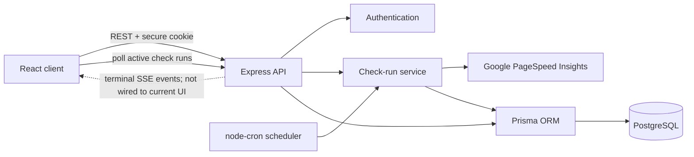

# SEO Track

[](https://github.com/developerRustam/seoTrack/actions/workflows/ci.yml)
[](https://seo-track-lyart.vercel.app/)
[](https://www.typescriptlang.org/)

SEO Track is a full-stack web application for monitoring website performance over time. It runs PageSpeed checks, stores historical Core Web Vitals, and presents results through a focused dashboard.

**Frontend deployment:** [seo-track-lyart.vercel.app](https://seo-track-lyart.vercel.app/). The frontend can be opened independently, but authenticated monitoring flows also require the deployed API to be available.

## What the project demonstrates

- A React and TypeScript frontend organized by product responsibilities
- Authenticated full-stack flows with HTTP-only session cookies
- PostgreSQL persistence through Prisma
- Background and on-demand website checks
- A backend SSE endpoint for terminal check events, while the current frontend polls active runs
- Automated frontend and backend quality gates in GitHub Actions
- Unit and component tests with Vitest and Testing Library

## Product capabilities

- Register and sign in to a private workspace
- Add websites and optional additional pages
- Run PageSpeed checks on demand
- Schedule checks hourly, every 6 or 12 hours, daily, weekly, or every 30 days
- Track performance score, LCP, CLS, and INP
- Review check history and metric trends
- Mark stale queued or running checks as failed so they do not remain active indefinitely

The data model and API include incident and script-snapshot structures. Automated incident creation and script detection are not implemented in the current check runner.

## Technology

| Area | Stack |
| --- | --- |
| Frontend | React 19, TypeScript, Vite, React Router |
| State | Redux Toolkit, React Redux |
| Data visualization | Chart.js |
| Backend | Node.js, Express 5, TypeScript |
| Database | PostgreSQL, Prisma, `@prisma/adapter-pg` |
| Authentication | JWT, HTTP-only cookies, bcrypt |
| Background work | node-cron |
| Check status | Polling in the frontend; terminal SSE events exposed by the backend |
| Testing | Vitest, Testing Library |
| Delivery | GitHub Actions, Vercel |

## Architecture



The frontend uses protected routes for project screens. The Express API owns authentication, project settings, checks, incident retrieval, and an SSE stream. Completed metric snapshots remain queryable independently from the external API response.

## Repository structure

```text
.
├── src/                     # React application
│   ├── app/                 # Router and application providers
│   ├── features/            # User-facing feature orchestration
│   ├── pages/               # Route-level screens
│   ├── shared/              # API, auth, utilities, and reusable UI
│   └── widgets/             # Larger dashboard components
├── server/
│   ├── prisma/              # Schema and migrations
│   └── src/
│       ├── app/             # Server configuration and scheduled jobs
│       ├── middleware/      # Authentication middleware
│       ├── routes/          # REST and SSE endpoints
│       ├── services/        # Check runs, PageSpeed, and event publishing
│       └── lib/             # Validation and domain helpers
└── .github/workflows/ci.yml # Frontend and backend quality gates
```

## Local development

### Prerequisites

- Node.js from a supported line: 20.19+, 22.12+, or 24+
- npm
- PostgreSQL
- A Google PageSpeed Insights API key for real checks

### 1. Clone and install

```bash
git clone https://github.com/developerRustam/seoTrack.git
cd seoTrack
npm ci
cd server
npm ci
cd ..
```

### 2. Configure the environment

Create the frontend and backend environment files:

```bash
cp .env.example .env
cp server/.env.example server/.env
```

Edit `server/.env` before continuing:

1. Replace the placeholder PostgreSQL password in `DATABASE_URL`.
2. Make sure the URL points to an existing database named `seotrack`, or change the database name in the URL.
3. Replace `JWT_SECRET` with a unique secret of at least 32 characters.
4. Add `PAGESPEED_API_KEY` to run real PageSpeed checks.

Generate a suitable JWT secret with Node.js:

```bash
node -e "console.log(require('node:crypto').randomBytes(32).toString('hex'))"
```

Never commit `.env`, real credentials, or production connection strings.

### 3. Create and prepare the database

Create the database with PostgreSQL tooling if it does not already exist:

```bash
createdb seotrack
```

Then generate the Prisma client and apply migrations:

```bash
cd server
npm run prisma:generate
npx prisma migrate deploy
cd ..
```

If `createdb` requires a specific PostgreSQL user or host, pass the appropriate local options and keep `DATABASE_URL` consistent with them.

### 4. Start both applications

Run the API:

```bash
cd server
npm run dev
```

In another terminal, run the frontend from the repository root:

```bash
npm run dev
```

The frontend defaults to `http://localhost:5173`; the API defaults to `http://localhost:4000`. API availability can be checked at `GET /health`.

## Environment variables

### Frontend

| Variable | Required | Purpose |
| --- | --- | --- |
| `VITE_API_URL` | Yes | Base URL of the Express API |

### Backend

| Variable | Required | Purpose |
| --- | --- | --- |
| `DATABASE_URL` | Yes | PostgreSQL connection string for an existing database |
| `DIRECT_URL` | No | Direct database URL for Prisma operations |
| `JWT_SECRET` | Yes | Session signing secret; minimum 32 characters |
| `CLIENT_ORIGIN` | No | Comma-separated allowed frontend origins; defaults to `http://localhost:5173` |
| `PAGESPEED_API_KEY` | For checks | Google PageSpeed Insights API key |
| `PORT` | No | API port; defaults to `4000` |
| `PAGESPEED_TIMEOUT_MS` | No | External API timeout; defaults to `45000` |
| `CHECK_RUN_STALE_MS` | No | Age after which unfinished checks are marked failed |
| `NODE_ENV` | No | Enables production cookie settings when set to `production` |

## Quality checks

Run the frontend checks from the repository root:

```bash
npm run lint
npm run test:ci
npm run build
npm audit --audit-level=high
```

Run the backend checks from `server/`:

```bash
npm run prisma:generate
npm run typecheck
npm run test:run
npm run build
npm audit --audit-level=high
```

GitHub Actions runs frontend lint, tests, build (including TypeScript compilation), and high-severity dependency audit, plus backend type-check, tests, build, and high-severity dependency audit for pull requests and updates to the main development branches.

## API overview

The server exposes route groups for:

- health checks;
- registration, login, logout, and session retrieval;
- projects and project settings;
- additional monitored pages;
- check runs, polling, and terminal SSE events;
- incident retrieval and historical metrics.

Authentication is cookie-based, so local and deployed client origins must be configured correctly for credentialed CORS requests.

## Current scope

SEO Track is an actively improved portfolio project. The current roadmap focuses on connecting the event stream to the frontend, implementing incident/script detection, reducing frontend bundles, broadening API and end-to-end coverage, strengthening request validation, and hardening production deployment.

## License

No repository-level license file is currently included. The backend package manifest declares ISC, but the repository as a whole should not be treated as licensed for reuse until a root license is added.
